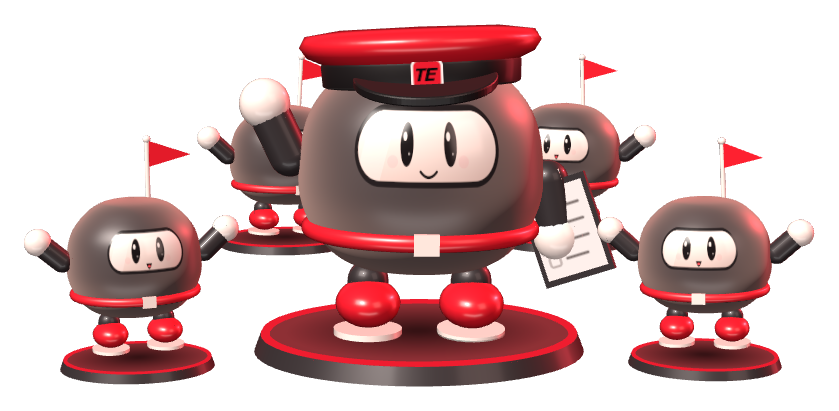

# ToolsEnabled

We build **[TESI](https://toolsenabled.ai/)** (*ToolsEnabled Super Intelligence*) — an AI that does real work for you on its own cloud computer in your browser.

Give TESI a task in plain language. It works on its own cloud computer (with a browser, files, and a terminal you can watch live), checks the result, and keeps your finished files ready to download.

- **Try TESI Free (no sign-up or email required):** [toolsenabled.ai/try](https://toolsenabled.ai/try/)
- **What is TESI?** [toolsenabled.ai/what-is-tesi](https://toolsenabled.ai/what-is-tesi/)
- **Plans & Pricing:** [toolsenabled.ai/pricing](https://toolsenabled.ai/pricing/)
- **Prepaid Agent API (HTTP 402):** [toolsenabled.ai/agents](https://toolsenabled.ai/agents/) · [llms.txt](https://toolsenabled.ai/llms.txt)

---

## Open-Source Developer Tools

Alongside TESI, we maintain open-source local MCP tools, coordination plugins, and public AI benchmarks:

### ToolsEnabled Fleet

<p align="center"></p>

**ToolsEnabled Fleet** is a plugin that gives a coding-agent session a team. Meet **Skip**, who runs the crew, and the Mates, who do the work.

Fleet lets one session hand work to several subagents that run in parallel and keep going while you do other things. It adds a shared task list, a ledger of your standing rules and open questions, and project memory that every agent can read. It runs on your own computer and sends nothing to ToolsEnabled.

```
claude plugin marketplace add ToolsEnabled/toolsenabled-fleet-claude-plugin
claude plugin install toolsenabled-fleet@toolsenabled
```

Then open a project folder in Claude Code and type `/toolsenabled-fleet:tefleet setup`.

### Featured Repositories

- **[teaa](https://github.com/ToolsEnabled/teaa)** — TEAA (ToolsEnabled Agent Architecture): Fleet, ToolsEngine, and Knowledge through one local MCP connection.
- **[toolsengine](https://github.com/ToolsEnabled/toolsengine)** — Portable stdio MCP server giving an agent client a sandboxed headless browser, workspace tools, and web fetch/extract.
- **[fleet](https://github.com/ToolsEnabled/fleet)** & **[toolsenabled-fleet-claude-plugin](https://github.com/ToolsEnabled/toolsenabled-fleet-claude-plugin)** — Contract-driven multi-agent coordination for MCP hosts and Claude Code.
- **[knowledge](https://github.com/ToolsEnabled/knowledge)** — Project briefs and decisions in a local Git repository, served over MCP.
- **[head-gasket-bench](https://github.com/ToolsEnabled/head-gasket-bench)** & **[engine-bench](https://github.com/ToolsEnabled/engine-bench)** — Public MCP & CAD benchmarks with independent scoring.

---

**Website:** [toolsenabled.ai](https://toolsenabled.ai/) · **X:** [@toolsenabled](https://x.com/toolsenabled) · **Reddit:** [u/toolsenabled](https://www.reddit.com/user/toolsenabled) · **Support:** support@toolsenabled.ai · **Security:** security@toolsenabled.ai

Founded by Joshua Pinckard. © ToolsEnabled, Inc. Open-source repositories are licensed as noted in each repo (MIT where indicated). ToolsEnabled is independent and is not affiliated with or endorsed by Anthropic, OpenAI, or any other AI provider; their products and names belong to their owners.
